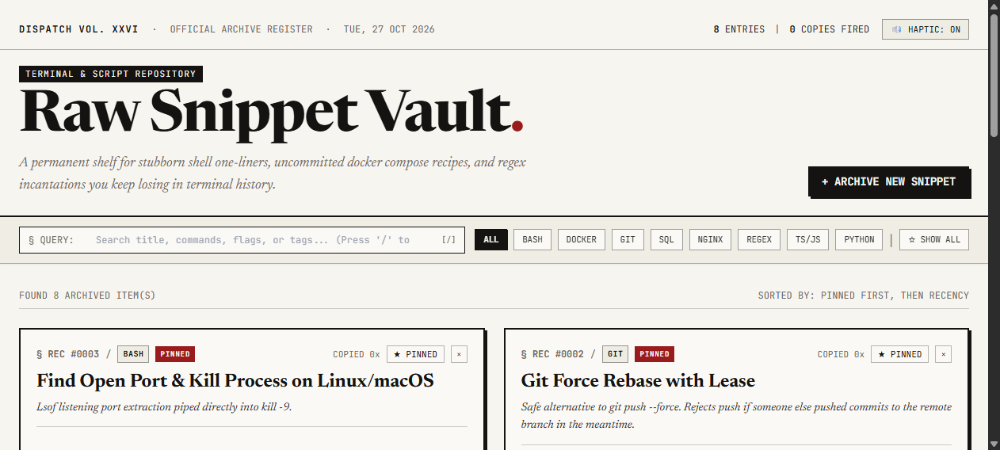

# Raw Snippet Vault §

> **Lightning-fast code snippet archive with an editorial raw aesthetic.**  
> Permanent shelf for stubborn one-liners, uncommitted docker recipes, and regex incantations you keep losing in shell history.



---

## The Problem
Every developer hoards critical commands:
- The exact `ffmpeg` flags that compress screen recordings without turning text into blurry soup.
- The `lsof` one-liner that kills rogue local dev ports when `taskkill` or `kill -9` complains.
- The PostgreSQL query to spot stalled transactions holding locks.
- The `git push --force-with-lease` variant you only use when rebasing shared staging branches.

Notes apps (Notion, Apple Notes) are too slow to load, clutter formatting, and strip tabs. Terminal bash history gets wiped across sessions or polluted by thousands of typo commands. 

**Raw Snippet Vault** treats code snippets like an archival newspaper register: instant to search, zero latency to copy, keyboard-first navigation, and zero AI fluff.

---

## 🏛️ Anti-AI Slop Principles

1. **Visual Dignity ("Archival Raw"):** No purple neon glow blobs, no generic Lucide icons pasted into cards, no fake bento grids. High-contrast typography pairing (`Newsreader` editorial serif + `JetBrains Mono`), aged paper palette (`#F7F5F0`), ink strokes, and solid offset shadows.
2. **Real Schema Validation (Zod):** Ingestion requests are strictly parsed with Zod schemas at trust boundaries (`@hono/zod-validator`). No mock forms that only trigger fake UI toasts.
3. **Intentional Haptic Feedback:** Web Audio API synthesizes subtle mechanical keyclick and confirmation tones on copy/navigation without external audio bloat (toggleable anytime).
4. **Fluid Responsiveness:** Built on precise flex/grid column rules that adapt seamlessly from dual-screen foldables and tablets to ultra-wide desktop displays.

---

## 🛠️ Stack & Architecture

- **Backend:** [Bun 1.4](https://bun.sh) + [Hono v4](https://hono.dev)
- **Validation:** [Zod v3](https://zod.dev) with `@hono/zod-validator`
- **Database:** FlyEnv MySQL (port 3306) with Bun SQLite fallback
- **Frontend:** [Vue 3.5](https://vuejs.org) + TypeScript + [Vite](https://vitejs.dev)
- **Data Layer:** [@tanstack/vue-query v5](https://tanstack.com/query/latest)
- **Styling:** Tailwind CSS (Archival Newsprint Design Tokens)
- **Local Dev Server:** Laravel Herd integration (`http://raw-snippet-vault.test`)

---

## 🚀 Getting Started

### 1. Install Dependencies
```bash
# Backend
cd backend
bun install

# Frontend
cd ../frontend
bun install
```

### 2. Run Local Development
```bash
# Terminal 1 — Backend (Port 3003)
cd backend
bun run dev

# Terminal 2 — Frontend (Port 5173)
cd frontend
bun run dev
```

### 3. Laravel Herd Integration (`http://raw-snippet-vault.test`)
Because the repository sits inside your Herd root (`C:\Users\Lenovo\Herd\raw-snippet-vault`), `public/index.php` acts as a reverse proxy:
1. Build frontend bundle:
   ```bash
   cd frontend
   bun run build
   ```
2. Start the Bun backend on port 3003:
   ```bash
   cd backend
   PORT=3003 bun run src/index.ts
   ```
3. Open `http://raw-snippet-vault.test` in your browser.

---

## 🧪 Testing

```bash
cd backend
bun test
```

---

## ⌨️ Keyboard Shortcuts

| Key | Action |
| --- | --- |
| `/` or `Ctrl + K` | Focus search query bar |
| `Esc` | Clear search / close modal |
| `Ctrl + Enter` | Save snippet in ingestion form |

---

## 📜 License
MIT © [DevisRoomi](https://github.com/DevisRoomi)
